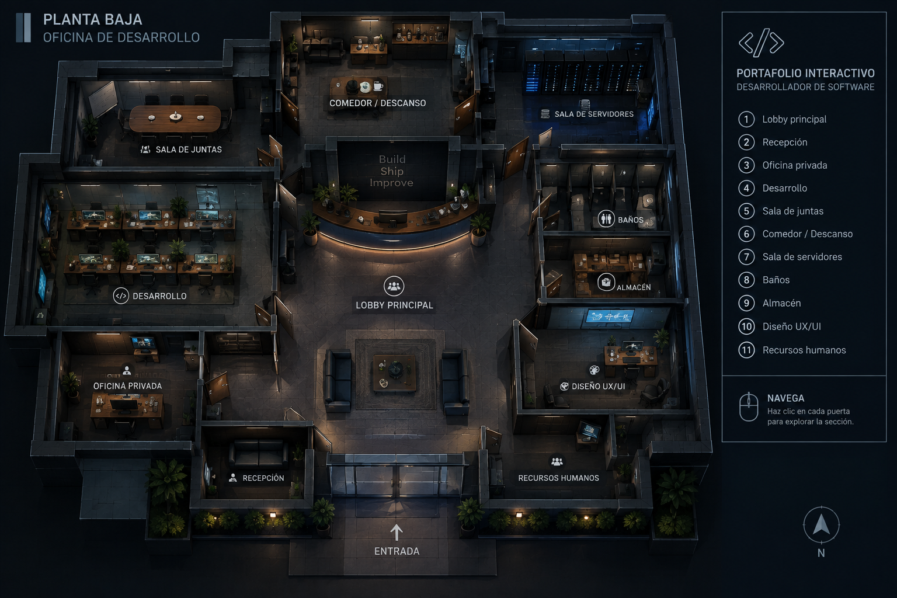

# Portafolio PS1 — Oficina de desarrollo

Portafolio interactivo de Roberto Bolaños inspirado en los survival horror de PlayStation 1. Recorres de noche la planta baja de una oficina de desarrollo, en primera persona o con cámaras fijas clásicas. Cada cuarto tiene una parte del portafolio: perfil, tecnologías, proyectos, arquitectura, experiencia, infraestructura y contacto.



## Cómo ejecutarlo

Requisitos: [Node.js](https://nodejs.org) 20 o superior.

En Windows basta con dar doble clic a **`iniciar.bat`**: instala las dependencias la primera vez, levanta el servidor y abre el navegador.

O desde una terminal:

```bash
npm install
npm run dev       # http://localhost:5173
npm run build     # verifica TypeScript y genera dist/
npm run preview   # sirve el build de producción
```

Cada push a `main` se compila con `.github/workflows/deploy.yml` y se publica en la rama `gh-pages`. Para verlo en línea, activa una vez **Settings → Pages → Deploy from a branch → `gh-pages` / `(root)`**: quedará en `https://robertoboz.github.io/Portafolio_interactivo/`.

### Parámetros de URL

- `?sala=desarrollo`: empieza en un cuarto (`lobby`, `recepcion`, `oficina`, `desarrollo`, `juntas`, `comedor`, `servidores`, `almacen`, `diseno`).
- `?debug`: expone `window.__portafolio` (store y posición del jugador) para pruebas automatizadas.

## Controles

| Tecla | Primera persona | Cámara clásica |
| --- | --- | --- |
| `W` / `S` | Avanzar / retroceder | Avanzar / retroceder |
| `A` / `D` | Desplazarse de lado | Girar |
| Ratón | Mirar alrededor | — |
| `←` / `→` | Girar sin ratón | Girar |
| `E` | Interactuar, abrir puertas, cerrar ventanas | igual |
| `M` | Plano de la planta | igual |
| `I` | Índice del portafolio (todo el contenido en texto) | igual |
| `Esc` | Soltar el ratón y pausar | Pausar |

Desde la pausa se puede continuar, abrir el plano o el índice, **volver al lobby** y cambiar los ajustes.

## Cuartos

| # | Cuarto | Contenido |
| --- | --- | --- |
| 1 | Lobby principal | Tablero con el nombre, terminal con el *Developer Log*, directorio (abre el plano) y entrada |
| 2 | Recepción | Bienvenida, tarjetas de presentación (contacto) y la **tarjeta de acceso** |
| 3 | Oficina privada | Perfil, trayectoria y expediente con **CV descargable**. Requiere la tarjeta |
| 4 | Desarrollo | Tecnologías: un escritorio por categoría del stack |
| 5 | Sala de juntas | Experiencia (proyector) y liderazgo y equipo (pizarrón) |
| 6 | Comedor / Descanso | Tablero de corcho personal (*con contenido de ejemplo por sustituir*) y cafetera |
| 7 | Sala de servidores | CI/CD, calidad y seguridad, operación y automatización (un rack cada uno) |
| 8 | Baños | Cerrado: "Fuera de servicio" |
| 9 | Archivo de proyectos | Un archivero por proyecto: iTeamApp, Kontrolia, GtrackApp, legados, cursos, componentes y automatización |
| 10 | Laboratorio técnico | Arquitectura (pizarrón), decisiones técnicas (terminal) y experimentos (banco de pruebas) |
| 11 | Recursos humanos | Cerrado por hoy |

Todos los textos están en `src/content/portfolio.ts`, tomados del CV y con descripciones genéricas por confidencialidad. Lo que no está en el CV aparece marcado como **contenido de ejemplo**.

## Ajustes

Se guardan en el navegador (`localStorage`):

- **Cámara:** primera persona o cámara clásica (fija, con control tipo tanque).
- **Resolución interna:** 240, 360 o 540 líneas. El 3D se escala con `image-rendering: pixelated`; la interfaz HTML siempre se ve nítida.
- **Temblor de vértices** (PS1) y **scanlines con viñeta**, activables por separado.
- **Sensibilidad del ratón.**

## Accesibilidad

- Pantalla inicial con **Entrar a la oficina**, la explicación de controles y **Ver portafolio sin recorrer**.
- **Índice** (`I`): todo el contenido en HTML navegable con teclado, agrupado por cuarto.
- Sin WebGL, la página muestra directamente el índice con un aviso.
- Diálogos con foco inicial, cierre con `E`/`Esc` y animaciones reducidas con `prefers-reduced-motion`.

## Arquitectura

```text
src/
├── App.tsx                        # Canvas + HUD; vista sin WebGL
├── content/portfolio.ts           # Todo el texto del portafolio
├── store/
│   ├── gameStore.ts               # Zustand: cuarto, inventario, puertas, ventanas, pausa, transiciones
│   └── settings.ts                # Ajustes persistidos
├── hooks/
│   ├── useInteractionKeys.ts      # E, M, I, Esc
│   └── usePointerLockSync.ts      # Captura del ratón según las ventanas abiertas
├── world/
│   ├── building.ts                # Cuartos, puertas, cámaras fijas, muebles sólidos (fuente única)
│   ├── interactions.ts            # Objetos interactuables (id, nombre, tipo, ayuda, acción) y detección
│   ├── collision.ts               # Círculo contra muros y muebles del cuarto actual
│   ├── player.ts                  # Posición, rumbo e inclinación del jugador fuera de React
│   ├── ps1Material.ts             # Temblor de vértices con un uniforme compartido
│   ├── officeTextures.ts, textures.ts, lowPoly.ts, controls.ts, pointerLock.ts
├── scenes/Office.tsx              # Niebla, luces globales, cámara según el modo, edificio
├── components/
│   ├── PlayerController.tsx       # Movimiento en ambos modos, colisiones e interacción
│   ├── FirstPersonCamera.tsx      # Cámara en los ojos con balanceo al caminar
│   ├── CameraRig.tsx              # Cámaras fijas por zona (modo clásico)
│   ├── CharacterAvatar.tsx, CharacterModel.tsx
│   ├── Building.tsx               # Monta los cuartos; solo el actual es visible
│   ├── rooms/                     # RoomShell (muros con vanos), DoorPanel (bisagra), props y un archivo por cuarto
│   └── ui/                        # Inicio, pausa, ajustes, índice, terminal, plano, mensajes, retícula…
└── styles/game.css
```

- **Puertas:** cada muro tiene vanos reales con dintel. La hoja gira sobre su bisagra hacia el otro cuarto (un hueco oscuro) y después la pantalla funde a negro. Si está cerrada, la hoja se sacude y aparece un mensaje claro.
- **Interacción:** proximidad más orientación. En primera persona el objeto debe estar al centro de la vista; la retícula se abre cuando hay algo al alcance.
- **Rendimiento:** solo el cuarto actual se dibuja y solo sus luces cuentan. Las texturas miden 8–128 px, no hay sombras dinámicas ni posprocesado, y el temblor de vértices es un uniforme compartido. Los LEDs de los racks se animan desplazando una textura, sin crear objetos. `useFrame` no crea objetos por fotograma.
- **Cuarto nuevo:** márcalo `built: true` en `building.ts` con cámaras y obstáculos, pon el `lock` de su puerta en `'none'`, crea su componente en `components/rooms/` y regístralo en `Building.tsx`. Sus objetos interactuables van en `world/interactions.ts` y sus textos en `content/portfolio.ts`.

Los créditos de recursos están en [`ASSET_CREDITS.md`](ASSET_CREDITS.md).

---

## Especificación original

## Objetivo

Crear una primera versión de un portafolio interactivo inspirado en los survival horror de PlayStation 1.

La primera entrega debe mostrar:

- Un cuarto 3D.
- Un personaje controlable.
- Cámara fija.
- Movimiento tipo tanque.
- Iluminación oscura.
- Niebla.
- Estética low-poly.
- Una puerta cerrada.
- Un monitor CRT interactivo.

No se deben implementar todavía inventario, mapa, múltiples habitaciones, combate ni enemigos.

---

## Stack

- React
- TypeScript
- Vite
- Three.js
- React Three Fiber
- @react-three/drei
- Zustand

---

## Inicio del proyecto

```bash
npm create vite@latest portfolio-ps1 -- --template react-ts
cd portfolio-ps1
npm install
npm install three @react-three/fiber @react-three/drei zustand
npm install -D @types/three
npm run dev
```

---

## Estructura inicial

```text
portfolio-ps1/
├── public/
│   ├── models/
│   │   ├── room.glb
│   │   └── character.glb
│   ├── textures/
│   └── audio/
├── src/
│   ├── components/
│   │   ├── Character.tsx
│   │   ├── FixedCamera.tsx
│   │   ├── Room.tsx
│   │   ├── Door.tsx
│   │   └── CRTMonitor.tsx
│   ├── scenes/
│   │   └── FirstRoom.tsx
│   ├── store/
│   │   └── gameStore.ts
│   ├── styles/
│   │   └── game.css
│   ├── App.tsx
│   └── main.tsx
├── README.md
└── package.json
```

---

## Escena

La escena debe representar un cuarto abandonado de una empresa tecnológica.

Elementos mínimos:

- Piso de concreto.
- Cuatro paredes.
- Una lámpara fluorescente.
- Una mesa.
- Un monitor CRT.
- Una puerta cerrada.
- Un personaje low-poly.
- Niebla ligera.
- Luz ambiental tenue.

La escena puede construirse primero con geometrías simples de Three.js. No es obligatorio usar modelos de Blender en esta etapa.

---

## Personaje

El personaje debe:

- Estar visible en tercera persona.
- Poder girar a la izquierda y derecha.
- Avanzar y retroceder.
- No atravesar las paredes.
- Mantener los pies sobre el suelo.

Controles:

```text
W o Flecha arriba: avanzar
S o Flecha abajo: retroceder
A o Flecha izquierda: girar a la izquierda
D o Flecha derecha: girar a la derecha
E: interactuar
```

El movimiento debe sentirse pesado y lento, similar a los survival horror clásicos.

---

## Cámara

Usar una cámara fija colocada en una esquina del cuarto.

La cámara debe:

- Mostrar al personaje y los elementos principales.
- No seguir directamente al personaje.
- Mantener siempre el mismo ángulo.
- Tener una perspectiva cinematográfica.

Posición inicial sugerida:

```ts
camera.position.set(6, 5, 8);
camera.lookAt(0, 1, 0);
```

---

## Estética PS1

Aplicar una apariencia retro usando:

- Modelos low-poly.
- Texturas pequeñas.
- Renderizado a baja resolución.
- Niebla.
- Pocas luces.
- Sombras simples.
- Animaciones limitadas.

Configuración sugerida:

```tsx
<Canvas
  camera={{ position: [6, 5, 8], fov: 45 }}
  dpr={1}
  gl={{ antialias: false }}
>
```

Agregar niebla:

```tsx
<fog attach="fog" args={["#111111", 4, 14]} />
```

Usar filtrado nearest-neighbor para las texturas.

---

## Interacción con el monitor

Cuando el personaje esté cerca del monitor y presione `E`, mostrar una interfaz HTML.

Contenido:

```text
DEVELOPER LOG #001

Nombre: Roberto Bolaños
Rol: Mobile Tech Lead
Especialidad: Flutter y desarrollo móvil

Estado del sistema: operativo
```

La interfaz debe incluir una opción para cerrarse.

Mientras el monitor esté abierto:

- El personaje no debe moverse.
- La escena debe permanecer visible detrás.
- Puede agregarse un efecto CRT con scanlines.

---

## Puerta

La puerta debe permanecer cerrada.

Cuando el personaje se acerque y presione `E`, mostrar:

```text
La puerta está cerrada.

Parece necesitar una tarjeta de acceso.
```

En esta primera versión no existe todavía la tarjeta.

---

## Estado global

Crear un store sencillo con Zustand.

Estados mínimos:

```ts
type GameState = {
  isInteracting: boolean;
  activeInteraction: "monitor" | "door" | null;
  setInteraction: (
    interaction: "monitor" | "door" | null
  ) => void;
};
```

---

## Criterios de aceptación

La primera versión estará terminada cuando:

- El proyecto se ejecute con `npm run dev`.
- Se vea un cuarto completo.
- El personaje aparezca dentro del cuarto.
- El personaje pueda moverse con controles tipo tanque.
- El personaje no atraviese las paredes.
- La cámara permanezca fija.
- Exista iluminación oscura y niebla.
- El monitor pueda inspeccionarse.
- La puerta muestre un mensaje al interactuar.
- La interfaz funcione en escritorio.
- No existan errores en consola.

---

## Restricciones

- No copiar modelos, sonidos, nombres, logotipos ni escenarios de Resident Evil o Silent Hill.
- Crear una experiencia original.
- No implementar enemigos.
- No implementar combate.
- No implementar más habitaciones.
- No agregar librerías sin justificar su uso.
- Mantener los componentes pequeños y separados.
- Usar TypeScript estricto.
- Evitar lógica compleja dentro de `App.tsx`.

---

## Prompt para Claude Code o Codex

```text
Lee este README completo antes de modificar el proyecto.

Construye una primera escena jugable para un portafolio 3D inspirado en los survival horror de PlayStation 1.

Implementa únicamente:

1. Un cuarto 3D.
2. Un personaje visible.
3. Movimiento tipo tanque.
4. Cámara fija.
5. Colisiones básicas.
6. Iluminación oscura.
7. Niebla.
8. Una puerta cerrada.
9. Un monitor CRT interactivo.

Usa React, TypeScript, Vite, Three.js, React Three Fiber, Drei y Zustand.

Empieza usando geometrías simples. No dependas de modelos externos para que la escena funcione.

Divide el código en componentes:

- Character
- FixedCamera
- Room
- Door
- CRTMonitor
- FirstRoom

Antes de escribir código, explica brevemente la arquitectura que vas a utilizar.

Después implementa el proyecto completo.

No agregues inventario, mapa, enemigos, combate ni múltiples habitaciones.

Al terminar:

- Ejecuta el build.
- Corrige errores de TypeScript.
- Revisa que no existan errores en consola.
- Actualiza este README con las instrucciones para ejecutar el proyecto.
```

---

## Siguiente entrega

Después de completar esta primera escena se podrá implementar:

- Animación del personaje.
- Cambio de cámaras.
- Inventario.
- Tarjeta de acceso.
- Segunda habitación.
- Sistema de proyectos.
- Audio ambiental.
- Efectos CRT más avanzados.
